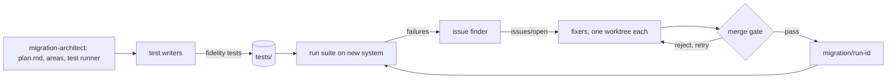

# migration-team

Agents and a skill that run an autonomous team through a code migration,
for hours or days, from Claude Code on your machine. The design follows
[how autonomous AI agents built the AWS emulator](https://www.aboutamazon.com/news/aws/how-autonomous-ai-agents-built-aws-emulator).

## Setup

```bash
cp agents/*.md ~/.claude/agents/

npx skills add -g https://github.com/Workiva/migration-team
```

Requires `git`, `bash`, and the `claude` CLI on your PATH.

## Usage

```
/migration-team Migrate the billing service from Python 2 Flask to Go
/migration-team --legacy ../catalog --brief ../migration-team/examples/prf/brief.md Port the production readiness framework in catalog to src/prf
/migration-team resume billing-go-20260512-143005
/migration-team status
```

The skill runs the migration-architect, asks you to confirm the plan and limits once,
then starts a detached driver script and returns. You can close the session.

```bash
cat .migration/<run-id>/progress.md          # where it is
tail -f .migration/<run-id>/logs/driver.log
touch .migration/<run-id>/STOP               # stop after the current round
```

After a crash or reboot,
`/migration-team resume <run-id>` (or `scripts/run.sh <run-id>`) requeues
interrupted work and continues. The result is the branch
`migration/<run-id>`; nothing is merged or pushed for you.

## The team

| Agent         | Job                                                                                   |
| ---           | ---                                                                                   |
| `migration-architect` | Plans the migration, defines the fidelity-test format and runner, writes the config    |
| `test-writer` | Per area, runs the **legacy** system and records its real behavior as fidelity tests   |
| `issue-finder`| Replays the suite on the new system; files issues grouped by root cause                |
| `fixer`       | Takes one issue in its own git worktree and fixes the root cause                       |
| driver + gate | `scripts/run.sh` loops the rounds; `scripts/gate.sh` decides what merges               |



Each round: test writers extend coverage for any area still pending, the
suite replays on the integration branch, the issue finder files issues for
new failures, and fixers (up to `PARALLELISM` at a time) work the open
issues. The run is complete when every area is covered, the suite is all
green, and no issues are open, for two rounds in a row.

### Briefs

Pass `--brief <file>` to hand the architect what you already know: legacy
and target commands, scope and non-goals, intentional divergences, target
repo rules, the starting branch. It treats them as authoritative, verifies
them, and flags contradictions in `plan.md`. The team stays generic; each
migration brings its own brief. See [examples/prf/brief.md](examples/prf/brief.md).

### Cross-repo migrations

The legacy system may live in a different repo and stack than the target.
Run the skill from the target repo and pass `--legacy`. The architect
records intentional **divergences** (renamed concepts, different storage,
changed API shapes) and writes an adapter so tests recorded from legacy can
replay against the new API. Fixers are told to follow the target repo's own
`AGENTS.md`, lint and coverage rules; the architect puts those checks in
`GATE_EXTRA_CMD`. Fixer commits start with the area, so the final branch can
be cut into PRs.

### Rules that keep it honest

- **The legacy system is the oracle.** Test writers record observed behavior;
  they never write expected output from reading code.
- **Fixers cannot edit tests.** The gate rejects any change to `tests/`.
- **The merge gate** requires: clean rebase, build passes, the issue's tests
  pass, no previously passing test regresses, optional extra check
  (`GATE_EXTRA_CMD`). Gates run one at a time; fixers run in parallel.
- **Agents are bounded.** One area per test writer, one issue per fixer, fresh
  context every session.
- **Stuck work is parked.** An issue that fails `MAX_ISSUE_ATTEMPTS` rounds
  moves to `issues/blocked/` for you. The run stops on no progress for
  `STALL_ROUNDS` rounds, or at `MAX_HOURS`.

## State

Everything lives in `.migration/<run-id>/` (excluded from git via
`.git/info/exclude`):

| Path                             | What                                             |
| ---                              | ---                                              |
| `plan.md`, `areas.txt`           | Architect's plan and area list                   |
| `config.env`                     | Commands and limits (edit while stopped)         |
| `tests/`                         | Fidelity tests, `FORMAT.md`, `run.sh`            |
| `issues/{open,claimed,resolved,blocked}/` | One markdown file per issue; moving the file is the claim |
| `progress.md`, `ledger.jsonl`    | Current status and per-round history             |
| `REPORT.md`                      | Final report                                     |
| `wt/`                            | Integration worktree and fixer worktrees         |
| `logs/`                          | Per-agent session logs and gate logs             |

## Config (`config.env`)

| Variable            | Default | Meaning                                              |
| ---                 | ---     | ---                                                  |
| `BUILD_CMD`         |         | Build/type-check the new system                      |
| `FIDELITY_CMD`      |         | Replay the suite; writes `PASS id`/`FAIL id` lines to `$RESULTS_FILE` |
| `GATE_EXTRA_CMD`    |         | Extra merge check (lint, security)                   |
| `PARALLELISM`       | 4       | Concurrent agents                                    |
| `COVERAGE_PASSES`   | 2       | Extra test-writer passes per area                    |
| `MAX_FIX_ATTEMPTS`  | 3       | Fixer sessions per issue per round                   |
| `MAX_ISSUE_ATTEMPTS`| 3       | Failed rounds before an issue is blocked             |
| `STALL_ROUNDS`      | 5       | Rounds without progress before stopping              |
| `MAX_HOURS`         | 72      | Wall-clock limit per driver session                  |
| `AGENT_BUDGET_USD`  | 5       | `--max-budget-usd` per agent session                 |
| `LEGACY_DIR`        | the integration worktree | Legacy source checkout, if it is another repo |
| `LEGACY_START_CMD`, `LEGACY_READY_CMD`, `LEGACY_STOP_CMD`, `LEGACY_URL` | | Start the legacy system for the writer phase and stop it after |
| `WRITER_PARALLELISM`| 1       | Concurrent test writers (they share one legacy instance) |
| `WORKTREE_SETUP_CMD`|         | Make a new worktree usable (link `.venv`, `node_modules` from `$MAIN_REPO`) |
| `AGENT_TIMEOUT_MIN` | 90      | Kill an agent session that runs longer              |
| `PERMISSION_MODE`, `ALLOWED_TOOLS` | `acceptEdits`, `Bash,Read,Edit,Write,Glob,Grep` | Headless agent permissions |

Agents run with broad shell access and no human watching. Use a machine or
container without production credentials. `run.sh --yolo` skips all
permission checks.
